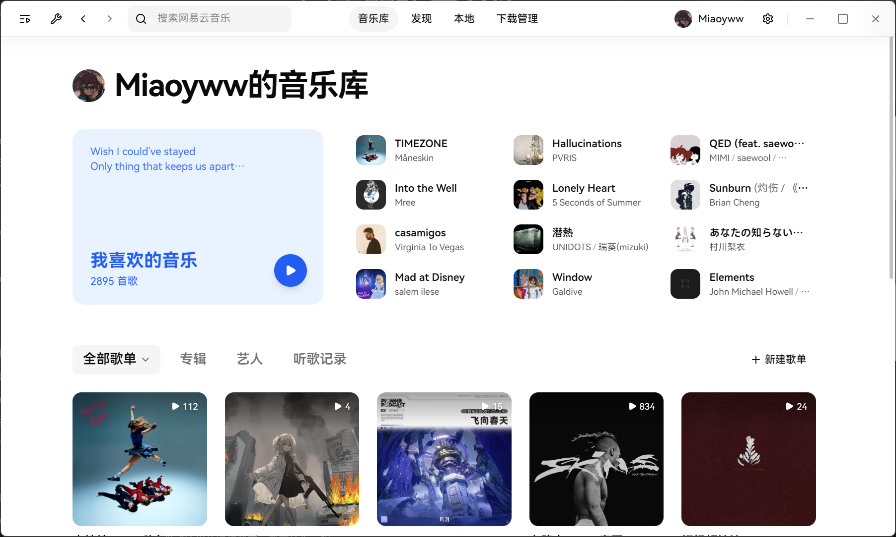
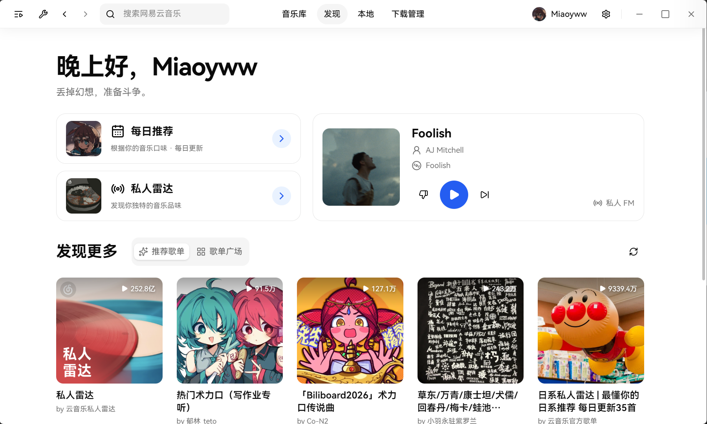

# NonsPlayer

**轻量 | 全平台 | 流媒体&本地**

## 灵感来源

NonsPlayer的诞生离不开以下优秀产品的启发：

- [YesPlayMusic](https://github.com/qier222/YesPlayMusic)
- [coriander_player](https://github.com/Ferry-200/coriander_player)
- [SPlayer](https://github.com/SPlayer-Dev/SPlayer)

## 特别鸣谢

- **[Zhuym](https://github.com/Zhuym07), [GooGuJiang](https://github.com/GooGuJiang)** - 为图标与 UI 设计提供重要帮助。
- **[NeteaseCloudMusicApiEnhanced](https://github.com/NeteaseCloudMusicApiEnhanced/api-enhanced/)**
- **[Apple Music-like Lyrics](https://github.com/Steve-xmh/applemusic-like-lyrics)**
- **[amll-ttml-db](https://github.com/Steve-xmh/amll-ttml-db)**

构建与发布流程见 [GitHub Release CI](docs/release.md)。

Android ARM64 试用 APK 的命令行构建与安装见 [Android 试用版](docs/android.md)，无需安装 Android Studio。

## 📜 开源许可

Copyright Miaoyww 2026.

Distributed under the terms of the [GPL-3.0 license](https://github.com/Miaoyww/Nons/blob/main/LICENSE).

## 实机演示

以下为 Windows 桌面端的实际运行截图。

