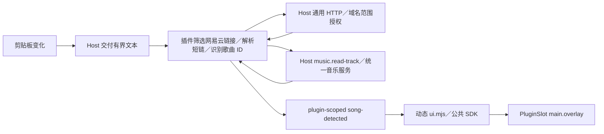

# 插件开发与使用

Nons 在现有播放器上增量提供 `Manifest + WASM Backend + React Frontend + Contributions`。网易云由默认随包的独立原生适配器提供，功能插件调用统一音乐服务，不接管来源注册或播放核心。灵动岛、下载与转换插件在各自独立仓库维护，通过插件管理安装。

## 架构与文件

| 部分         | 位置与职责                                                                                                                                                                                                            |
| ------------ | --------------------------------------------------------------------------------------------------------------------------------------------------------------------------------------------------------------------- |
| Rust Host    | `app/src-tauri/src/plugins/`：Manifest、安装、管理、Wasmtime、权限、事件、存储、剪贴板与资源协议                                                                                                                      |
| 公共 ABI     | `plugins/wit/plugin.wit`：`nons:plugin@1.0.0`；Guest 初始化、关闭、方法调用；Host 高层 Capability                                                                                                                     |
| React Host   | `app/src/plugins/`：动态模块、贡献 registry、PluginSlot、PluginPageHost、生命周期与 SDK                                                                                                                               |
| 公共类型     | `packages/plugin-sdk/`：发布为 `@nonsplayer/plugin-sdk`，含类型、WIT、Manifest schema 与构建 CLI，不引用宿主源码                                                                                                      |
| 真实插件     | `netease-island` 独立仓库：Rust Component 与 React UI，通过公开 SDK 构建                                                                                                                                              |
| 非随包插件   | [ncm-converter](https://github.com/Miaoyww/ncm-converter)、[netease-download](https://github.com/Miaoyww/netease-download)：源码、测试与 Release 在各自仓库；注册信息在[插件目录](https://github.com/Miaoyww/plugins) |
| 构建         | `scripts/build-plugin.mjs`、`plugin-build-ui.mjs`、`package-plugin.py`：两端构建、React 外部化与 ZIP                                                                                                                  |
| 测试 fixture | `plugins/runtime-fixture/`：资源耗尽／错误验证，不随包安装                                                                                                                                                            |

宿主启动、IPC 和协议注册接入原 `lib.rs`；音乐读取经统一 MusicService／AdapterManager 路由到内置网易云适配器。App 增加通用 Provider／Slot，已有工作区和导航增加插件页面分支，设置增加插件管理。Theme 共享原偏好与 CSS tokens，播放 facade 订阅原状态及进度，不创建另一套播放器。

职责归属见 [插件职责边界](adr/0005-plugin-capability-boundary.md)。通用能力提供系统操作；播放器领域能力复用已有业务服务；插件组合这些能力完成自己的业务。下面列出的接口为当前实现，不代表提前实现所有系统能力。

[ADR 0006](adr/0006-music-provider-adapters.md) 阶段一至五已完成，统一客户端、账号管理与受限外部 WASM 验证桥已接入，规格与迁移注意事项见 [音乐适配器契约与迁移记录](music-adapters.md)。外部测试适配器复用 WIT transport，但使用独立的音乐方法、描述符校验和来源注册表，不获得功能插件 Host Capability。默认网易云已拆为 `adapters/netease` 原生源码包，并有独立适配器设置入口；第三方音乐适配器可在桌面端通过设置导入 ZIP／目录，安装前确认 Host 权限，升级失败保留旧包，卸载默认保留账号和专属状态。不能用功能插件 Manifest 注册音乐适配器；桌面端商店支持下载安装，Android 导入尚未开放。插件 API 与 UI API 已升至 2.0.0，旧数字歌曲接口和平台账号接口已移除；旧插件明确提示版本不兼容，须迁移并重新安装。

## 构建与安装

灵动岛在 `netease-island` 独立仓库构建，要求 Rust 1.95、Node.js 22 或更新版本和 pnpm：

```powershell
cargo install cargo-component --version 0.21.1 --locked
rustup target add wasm32-unknown-unknown
cd ../netease-island
pnpm install --frozen-lockfile
pnpm test
pnpm build
```

Cargo Component 根据 WIT 生成 `src/bindings.rs`，产出真正的 Component。生成的 bindings 与 target 不提交；Cargo.lock 提交。宿主只链接 Nons WIT，不提供任意 WASI filesystem、network、clipboard 或 process imports。

React 从 `frontend/index.tsx` 构建 ESM。TypeScript 检查使用公开 SDK 类型；React、JSX runtime 和 SDK 保持 external，并重写到同一插件 URL 下的 `_host/` 合成模块。桥接引用宿主 React singleton，产物检查拒绝 React 副本。动态 chunk 放入 `assets/`；样式可使用宿主 CSS tokens、组件类名或插件自己的 style／资产，不依赖宿主源码路径。宿主构建同时接受 `@nonsplayer/plugin-sdk` 与仓库内的 `@app/plugin-sdk` 包名。

仓库外插件使用发布的 SDK：

```bash
pnpm add -D @nonsplayer/plugin-sdk react @types/react
npx nons-plugin create my-plugin --name "我的插件"
cd my-plugin && pnpm install && pnpm build
```

包版本独立于应用版本；包的 `nons.pluginApi`／`nons.uiApi` 元数据声明对应 API 版本，用于校验 Manifest 的 `engines` 范围。`nons-plugin build` 执行 TypeScript 检查、前端打包、Manifest 与产物校验，并生成 `<id>-<版本>.zip`；声明 `backend` 时先运行 `cargo component build`。`nons-plugin validate <manifest> --root <目录>` 单独校验 Manifest 与打包文件。WIT 位于 `node_modules/@nonsplayer/plugin-sdk/wit/plugin.wit`，Manifest schema 位于 `node_modules/@nonsplayer/plugin-sdk/schemas/manifest.schema.json`。

灵动岛产物位于独立仓库的 `dist/`，安装包为 `netease-island-<版本>.zip`。主仓库不构建或随包分发灵动岛；在设置 → 插件中安装 ZIP 并确认权限。仓库内的 `runtime-fixture`、`music-fixture`、`settings-fixture` 与 `ui-fixture` 仅用于验证宿主契约，不作为发布插件。

设置 → 插件与适配器共用“已安装／安装”标签页布局。已安装页默认显示全部插件，支持按名称、ID 或描述搜索，并按已加载／未加载／加载异常筛选，不展示权限标签或权限筛选；启用前仍完整展示权限并确认授权。安装页提供商店、目录或 ZIP 安装，也可直接拖入 ZIP。功能插件 ZIP 根必须直接包含 `manifest.json`，复制到 `<app_data>/plugins/<id>/` 后运行；首次安装保持关闭，可在已安装页启用。管理支持重新发现、加载、卸载运行实例、重新加载、停用和删除；删除默认保留配置、独立存储和专属数据目录，主动关闭保留选项后才清理。

商店默认读取 `https://nons-plugn.miaoyww.top/index.json`，可在应用中切换到 `https://raw.githubusercontent.com/NonsPlayer/plugins/meta/index.json`；索引来源显示在界面并保存为设备设置。支持按名称、ID、描述或标签搜索、查看详情与手动检查更新。安装包始终从索引中的 GitHub Release 地址下载，宿主逐跳检查下载域名、限制大小，并验证 SHA-256、包身份、版本与兼容性；确认安装时再次核对目录和产物，下载失败不修改已安装包。源码型适配器不提供安装或构建操作，随包条目显示“官方已随包安装”，其他条目显示“作者尚未完成，暂不可安装”。封禁、不可用或不兼容条目不能安装；弃用条目在确认时提示。没有后台自动安装更新。

商店卡片读取条目的 `total_download_count` 显示下载总量：小于 1000 时显示整数，达到 1000 后使用 `k`，四舍五入保留最多一位小数并省略末尾零；零值显示 `0`，缺失或无效统计显示“暂无统计”。悬浮提示及读屏标签提供完整数字。

功能插件原位升级只接受更高版本，安装前确认新版本权限与前端信任；本地预览后重新检查身份、版本及授权范围。升级保留配置、键值、专属数据、目录授权与凭据，并保留原启用和加载状态。已加载插件等待新版前端导入、贡献导出检查及 `activate()` 的启动确认，15 秒内失败或未完成则恢复旧包、授权与加载状态；旧版恢复后也重新确认启动。后续页面渲染或运行中的错误不属于安装事务回滚范围。恢复本身失败会明确提示并保留恢复文件；不保证进程崩溃恢复，也不撤销插件已经执行的外部副作用。

桌面端安装适配器页支持选择或拖入单个 ZIP／目录。包根包含 `manifest.json`，Component 位于包根的 `adapter.component.wasm` 或 `dist/adapter.component.wasm`；压缩包也可用单个外层目录包裹上述内容。安装前显示来源、版本和 Host 权限，勾选信任后复制到 `<app_data>/adapters/<source>/` 并加载，启动时恢复已授权包。升级只接受更高版本，加载失败恢复旧包；卸载默认保留账号与专属状态，可主动选择清理。

## Manifest

编辑器 schema：`plugins/manifest.schema.json`。Rust 是运行时权威校验器，额外验证 SemVer、API 范围、路径、Windows 保留名、扩展引用、权限和文件存在性。

```json
{
  "id": "netease-island",
  "name": "灵动岛",
  "description": "识别剪贴板中的网易云音乐链接，在灵动岛中查看歌曲并快速播放。",
  "repository": "https://github.com/Miaoyww/Nons",
  "version": "1.0.0",
  "backend": "backend.wasm",
  "frontend": "ui.mjs",
  "permissions": ["clipboard:read", "http:request", "music:metadata", "ui"],
  "httpHosts": ["music.163.com", "y.music.163.com", "m.music.163.com", "163cn.tv"],
  "engines": { "app": "^1.0.0", "pluginApi": "^2.0.0", "uiApi": "^2.0.0" },
  "contributes": {
    "views": [{ "id": "island", "slot": "main.overlay", "export": "DynamicIsland" }],
    "pages": [],
    "navigation": []
  }
}
```

`description` 与 `repository` 均可省略或为 `null`，兼容旧 manifest；描述为 1 至 1024 个字符的非空纯文本，代码仓库为最多 2048 个字符且不含空白或凭证的 HTTP(S) URL。插件列表展示描述和仓库入口，搜索包含描述；缺失字段不显示对应信息。仅更改这两项元数据不影响既有权限授权。

backend／frontend 可独立省略，但至少有一个入口。UI 贡献必须声明 frontend 与 `ui`。未知字段或权限拒绝加载；改动已安装插件的版本或权限需要重新安装并确认。commands、menus、settings、shortcuts 仅保留声明字段，当前不执行。contextMenus 的歌曲入口已执行，见下节。

`http:request` 与 `httpHosts` 一同声明，域名最多 32 个，接受精确的小写 DNS 域名或单独的 `*` 项；`*` 匹配任意 DNS 域名，不支持 `*.example.org` 等子域通配符。URL 仍不允许非 HTTP(S) 协议、嵌入凭证、非默认端口、IP 或单标签主机名。启用前显示域名范围；包含 `*` 时以敏感权限高亮并警告插件可向任意域名发送其可读取的数据，与账户凭证同时授权时 Cookie 也可能被发送到其他网站。授权记录绑定插件版本、权限与域名集合，重启后范围变化也需重新确认。历史授权没有范围记录时先保持关闭，用户重新确认后启用；`clipboard:music-links` 已移除，不再识别该权限。灵动岛 1.3.0 需重新安装并授权。

## Host Capability 与 SDK

前端捕获并恢复的失败可调用 SDK 的 `reportCaughtError(operation, cause)`；它复用宿主的脱敏、去重和有界日志队列。Backend 可调用 `diagnostic.report`，参数为 `{operation,message}`：operation 为 1–64 字节的字母、数字、点或连字符，message 最多 4096 字节，不接收额外字段；仅活跃实例可用，每个实例每秒最多 16 条。错误消息由统一日志出口脱敏，不应主动传入请求、响应或凭据正文；诊断上报失败不递归上报。Host 调用失败即使被 Guest 恢复，也会记录操作与原始原因。

WIT Host 的 `call(operation, args-json)` 返回 JSON 或业务错误，身份来自 Store，Guest 不能指定另一个 pluginId。当前操作：

| 操作                     | 权限                         | 行为                                                                                |
| ------------------------ | ---------------------------- | ----------------------------------------------------------------------------------- |
| `clipboard.read-text`    | `clipboard:read`             | `{}` 读取当前剪贴板文本；变化通过 `event:clipboard-text` 的 `{text}` 交付后端       |
| `http.request`           | `http:request` + `httpHosts` | `{url,method?,timeoutMs?,responseType?}` 请求授权域名，返回 `{status,headers,body}` |
| `music.read-track`       | `music:metadata`             | `{reference: EntityRef}` 返回统一 `MusicTrack`，ID 是来源内不透明字符串             |
| `events.emit`            | 活跃加载实例                 | `{event,payload}` 发布自己的事件                                                    |
| `storage.get/set/delete` | `storage`                    | 操作自身的 JSON 键值空间                                                            |
| `player.read`            | `player:read`                | 读取经过裁剪的播放状态，不提供本地文件路径                                          |
| `player.control`         | `player:control`             | pause、resume、next、previous、stop，进入既有播放命令队列                           |
| `music.play-track`       | `player:control`             | `{reference: EntityRef, mode: "now" 或 "next"}` 经统一曲目服务展开并交给播放核心    |

`netease.get-song`、`music.get-song`、`netease.play-song`、`player.play-song` 已移除，不提供转发别名。配置与文件操作见 [插件配置开发](plugin-configuration.md)。

公开 React API：

| API                                      | 返回／用途                                                                                                                                 |
| ---------------------------------------- | ------------------------------------------------------------------------------------------------------------------------------------------ |
| `usePluginBackend()`                     | `call<T>(method, args?)`；自动绑定身份与加载代次                                                                                           |
| `usePluginClipboard()`                   | `readText()` 读取文本；`subscribe(callback)` 订阅文本变化并返回清理函数；需 `clipboard:read`                                               |
| `usePluginHttp()`                        | `request({url,method?,timeoutMs?,responseType?})`；需 `http:request` 与声明域名                                                            |
| `useMusicSource()` / `useSongPlayback()` | `getTrack(reference)` 返回统一曲目；`useSongPlayback()` 返回 `(reference, mode)` 播放函数，权限分别是 `music:metadata` 与 `player:control` |
| `usePluginEvent<T>(event)`               | 当前事件最新 payload；订阅随组件卸载清理                                                                                                   |
| `usePluginStorage()`                     | 异步 get／set／delete；缺失值为 null                                                                                                       |
| `usePluginNavigate()`                    | 在当前插件命名空间内导航，参数为 `/child` 等相对插件根路径                                                                                 |
| `usePluginRoute()`                       | 当前插件的 pathname 和 search                                                                                                              |
| `usePlayer()`                            | 原播放状态和进度；读取需 player:read，control 还需 player:control                                                                          |
| `useTheme()`                             | 原主题偏好 light／dark／system；实际颜色使用宿主 CSS tokens                                                                                |
| `useCoverSource()`                       | 复用宿主封面缓存和失败回退                                                                                                                 |
| `Button`                                 | 宿主已有 Button；不打包另一份 UI 实现                                                                                                      |
| `Progress`                               | 宿主已有 Progress；`value`／`max` 使用相同单位，`value: null` 表示进度未知，支持 `aria-label`                                              |
| `SongArtists`                            | `{song}` 复用宿主 ArtistLinks，按结构化艺术家 ID 跳转宿主艺术家页，需 ui                                                                   |
| `SongLikeButton`                         | `{song,onError}` 复用宿主收藏按钮和账号状态，收藏至我喜欢的音乐，需 ui；未登录、收藏状态未就绪及提交中禁用                                 |
| `useSongPlayback()`                      | `(id,mode) => Promise<void>`，使用 scoped Host Capability，需 player:control 和 music:metadata                                             |

SDK 不要求手写 pluginId。所有 SDK 请求经过 `nativeCall` 和 scoped IPC；禁用／reload 后即使 Promise 晚返回，SDK 也拒绝旧结果。事件内部命名为 `plugin:<id>:<event>`，共用 Tauri transport，但 SDK 只读取自身 Scope。订阅在实例卸载时删除；每实例只保留有界的最新事件，不承诺持久历史或初始化之前的事件重放。

宿主播放同步将轻量状态、队列与进度分别发布，队列仅在修改曲目或播放顺序时传输；初始化和主 WebView 重连读取同一时点的完整快照，再按事件序号和队列版本合并并发更新。公开 SDK `usePlayer()` 的返回结构和权限不变，由宿主按需订阅状态及进度后组装，插件无需直接订阅内部播放事件。

### API 1.3.0：文件工具与任意文件权限

manifest 的可选 `fileRoots: ["*"]` 须同时声明 `files:selected`。启用界面明确提示可读取、创建、修改和删除当前用户能够访问的任意文件，具备网络权限时可能发送文件内容；扩大到 `*` 需要重新授权。省略或 `[]` 沿用已有目录授权，专属数据目录仍由 `files:data` 控制。当前只支持 `*`，不支持路径 glob 或固定目录声明。

获授权插件可用 `root: "*"` 和完整绝对 `path` 调用已有文件 API；普通授权根仍使用相对路径。句柄绑定插件／加载代次，停用关闭，SDK 拒绝旧结果；通配符不绕过当前用户的系统文件权限。文件系统根最多 32 个、实例打开文件仍最多 16 个。`rename`／`publish` 的目标须在相同文件系统根内；`files.open-directory` 使用通配根时另提供绝对 `path`。

| SDK／操作                                                       | 行为                                                                                                                                                                                                                       |
| --------------------------------------------------------------- | -------------------------------------------------------------------------------------------------------------------------------------------------------------------------------------------------------------------------- |
| `usePluginFiles().pickAudio(extensions?)`／`files.pick-audio`   | 原生多选音频，可筛选支持的扩展名（如 `["ncm"]`），最多 128 个，返回 `{root,path,name}[]`；已获 `*` 时返回绝对路径，否则选择器明确授权所在目录读写，返回目录根和相对文件名。取消返回空数组。                                |
| `usePluginFiles().decodeAudio(root,path)`／`files.decode-audio` | 恢复支持的音频容器，当前支持 NCM → 原始 MP3／FLAC；返回 `{path,format,bytes}`，其中 bytes 为音频正文大小。默认同目录、保留源文件与歌曲信息／内嵌封面、同名失败不覆盖。单文件 256MiB，全局最多 2 个转换，阻塞线程流式读取。 |
| `MusicPageHeader`                                               | 插件复用宿主页面标题。页面 shell 仍由 `MusicWorkspace` 提供。                                                                                                                                                              |

工具页面在 navigation 条目声明 `category: "tool"`，宿主显示已加载实例的入口卡片。桌面工具入口位于设置左侧，与设置共用左右布局，左侧列出工具，右侧直接使用所选工具，默认选中首项；插件内导航沿用 `/plugins/<id>/*`，独立于工作区历史，关闭弹窗或切换工具时卸载原工具页面。弹窗内的 `library-heading` 和 `MusicPageHeader` 沿用设置页标题字号，插件无需自行判断宿主布局。Android 继续使用工具工作区页面与应用历史。省略 category 保留原主导航入口；同一工具不再占用顶栏独立按钮。

`ncm-converter` 是独立前端工具插件，源码位于 [Miaoyww/ncm-converter](https://github.com/Miaoyww/ncm-converter)，使用 `fileRoots: ["*"]`，无网络权限。批量串行转换，失败后继续，可重试失败项；关闭页面停止后续项目，当前原生转换完成后结束。支持“完成当前文件后停止”，不承诺页面关闭／重启后的任务恢复。此工具恢复原始编码，不做 MP3 ↔ FLAC 转码。本地 NCM 播放由宿主音频格式支持提供，无需启用转换页面。

在插件仓库执行：

```powershell
pnpm install
pnpm build
```

在设置 → 插件中安装 `ncm-converter-<版本>.zip` 并启用确认权限，随后从“工具”卡片进入。依赖来源与 NCM Rust 库的兼容补丁见 `app/src-tauri/vendor/ncmdump/NONS-PATCHES.md`；用户提供的 C++ 参考仓库克隆到播放器项目的同级 `ncmdump`，不作为运行时依赖。

可选模块 `activate()` 可以返回清理函数；清理会在停用、reload 和卸载时调用。组件应使用 React effect 清理自己的定时器及其他副作用。

## 灵动岛数据流



Host 自动观察新变化，不在启动时重放旧内容；插件可以显式调用 `readText()` 读取当前文本。没有已加载且授权的插件时停止监听。文本读取统一通过官方 `tauri-plugin-clipboard-manager`，在后台线程执行；该官方插件不提供变化监听，Windows 保留 clipboard-win 的事件 Monitor，macOS/Linux 保留 clipboard-rs Watcher（500 毫秒间隔），监听回调同样通过官方插件读取。原文最多 16KiB，通过 scoped 事件交付授权实例；宿主合并待处理变化，消费或停止监听后清理待处理原文，不写剪贴板、不持久化或记录内容。前端订阅清理函数可重复调用，停用自动清理；旧加载代次的事件与异步结果被拒绝。Android 试用版仍不开放插件剪贴板读取与监听。

应用内歌曲信息、分享链接的文本复制，以及桌面封面图片复制，均使用官方 clipboard-manager 插件。主窗口仅获文本写入权限；插件窗口没有直接读写剪贴板的 Tauri 权限，读取仍经过宿主按插件授权。封面继续复用原有资源读取与 64MiB 图片解码预算，转换为 RGBA 后交给官方插件写入，不自行管理系统剪贴板句柄或图片格式。

通用 HTTP 复用独立连接池，当前支持 GET／HEAD、UTF-8 文本或仅响应头；每次请求最多 3 秒、响应头 4KiB、文本正文 8KiB、URL 2048 字节。宿主不附带网易云 Cookie，不自动跳转，不缓存响应；收到跳转后由插件决定是否继续请求，每次都校验授权域名、HTTP(S)、账号密码及默认端口。停用后取消正在等待的请求；接口上限仍受现有 IPC 总大小约束。

网易云域名、歌曲 URL 格式和跳转规则全部在独立 `netease-island` 仓库的 `backend/src/links.rs`。插件最多提取 4 个候选，优先直接歌曲链接；短链共享最多 3 次请求，每次 500 毫秒，以给后续 3 秒元数据查询留出 WASM 的 5 秒执行预算。每一步检查网易云域名，支持 HTTP redirect 和相对跳转，不执行网页脚本；选取首个可识别的歌曲。HTTP 和查询失败保留实例，等待后续复制。

Guest 查询歌曲失败时不产生预览，保留实例以等待后续复制。成功时发出包含结构化艺术家信息的 Song DTO；React 插件绘制封面、标题、可点击歌手、关闭与操作区域。新歌曲替换旧预览；同歌曲 30 秒内去重；8 秒后收起，鼠标悬停或键盘聚焦暂停倒计时，Escape／关闭按钮可收起。1.1.0 新增 player:control 权限，立即播放替换队列，下一首播放使用既有 PlayNext 命令；收藏复用宿主账号与写入缓存失效规则，成功与失败均提供反馈。切换歌曲时重建操作状态，旧请求不覆盖新提示。已安装的 1.0.0 需重新安装新版并确认新增权限。

## 新 view／page 插件

仓库内项目沿用 `plugins/<id>/manifest.json`、可选 backend 与 `frontend/index.tsx` 结构，更新各 Cargo package 名和 SDK tsconfig 路径；仓库外项目使用 `nons-plugin create`，从发布包获取类型、WIT 与 Manifest schema。仓库内构建运行：

```powershell
node scripts/build-plugin.mjs <id>
```

view 导出命名 React Component，并在 views 中关联导出与 `main.overlay`。页面通过 pages 与 navigation 声明，例如：

```json
{
  "pages": [{ "id": "inspector", "path": "/", "export": "InspectorPage" }],
  "navigation": [{ "id": "inspector-entry", "label": "检查器", "page": "inspector" }]
}
```

页面入口统一为 `/plugins/<id>/*`，使用现有应用内历史而非新建全局 router。按最长页面路径前缀选择 contribution；同一页面的子路径变化保留组件状态，离开该页面后卸载。组件从 SDK 获取子路径，并用 `usePluginNavigate()` 导航；不得跳出自身命名空间。没有额外交付网易云示例页面，桌面探测中的临时页面仅用于验证。

工作区插件页面由宿主统一包裹 `MusicPage`，插件只渲染页面内容；布局与滚动验收遵循 [页面 shell 与滚动](architecture.md#页面-shell-与滚动)。

## 边界与资源预算

- WASM：64MiB 线性内存、1000 万 fuel／调用、5 秒执行期限；Host 网络查询 3 秒；异步等待可取消，epoch 与 fuel 防止 guest 独占线程。最多同时加载 4 个 WASM 插件，单实例最多 16 个待处理请求。
- IPC／事件／存储单值最多 64KiB；事件最多 32 次／秒；插件存储不设总量或 key 长度上限；安装最多 1024 文件、64MiB 解压总量，WASM 入口 16MiB，UI／资源单文件 8MiB。
- SDK、元数据和资源都校验加载代次。trap／超时／资源耗尽撤销该实例，普通 Guest 业务错误保留实例。原播放队列及音频线程不承担插件执行。
- `plugin://` 服务只允许活跃插件的前端入口、assets 和合成 Host 模块；规范化路径、拒绝链接／junction、单资源最多 8 MiB，按文件扩展名推断 Web MIME（未知类型回退 `application/octet-stream`）。静态资源支持 GET、HEAD 和单区间 Range，以供浏览器媒体加载与定位；无效区间返回 416，多区间回退完整响应。响应设置 `no-store` 和有限 CORS，不开放通用 filesystem scope。
- React 前端是受信任代码，与主 UI 共享并常驻主 WebView，以支持 WebAudio 和系统媒体控制；前端插件的下载、计时器与页面状态也会继续运行。SDK 身份、存储、事件和路径约束不等于防恶意 JS 沙箱；它仍可能直接操作 DOM、调用其他可见宿主接口或自行创建副作用。单个模块的 JS／浏览器 ESM 缓存无法强制回收，主线程循环也不能由 WASM fuel 终止。只安装可信前端。
- Store 上限仅覆盖 guest 线性内存等资源，不代表 Wasmtime JIT、Host、WebView 或全进程内存上限。当前没有独立 WASM worker 进程、签名或权限撤销后的 JS 强制终止；频繁 reload 的 ESM 模块记录可能留在 WebView，必要时重启应用。
- Windows 已验收；macOS/Linux 原生构建、播放与剪贴板观察尚需对应环境验证，Linux 当前为 X11 后端。音频统一使用系统 WebView。

## Windows 子进程与独立窗口

插件 API / UI API 2.1.0 提供 `process:spawn` 与 `window:manage`。两项能力仅支持 Windows，其他平台明确返回不支持；权限扩大后须重新授权。它们不取消 WASM 执行预算，也不改变前端可信代码的边界。

`process:spawn` 为敏感权限：可启动当前系统用户能运行的任意程序，程序的文件与网络访问不受插件目录、HTTP 域名授权限制。通过 `usePluginProcesses()` 或 `client.call` / WASM `host.call` 使用：

| 操作                  | 参数与结果                                                                                                                                                         |
| --------------------- | ------------------------------------------------------------------------------------------------------------------------------------------------------------------ |
| `process.spawn`       | `{program,args?,cwd?}` → `{id,pid}`；程序与工作目录为绝对路径，参数最多 128 项；不自动调用 Shell，继承宿主环境，不显示控制台                                       |
| `process.get`         | `{id}` → `{id,pid,state,exitCode}`；状态为 `running/exited/terminated`                                                                                             |
| `process.read`        | `{id,stream:"stdout"或"stderr",cursor?,maxBytes?}` → `{data,cursor,nextCursor,total,dropped,eof,error}`；data 为 base64，默认及最多读取 16KiB，后续传回 nextCursor |
| `process.write`       | `{id,data}` → `{queuedBytes}`；base64 输入最多 16KiB，仅确认入队，不保证程序已消费                                                                                 |
| `process.close-stdin` | `{id}`；排空已排队输入后关闭标准输入                                                                                                                               |
| `process.terminate`   | `{id}`；终止进程树，保留输出和状态                                                                                                                                 |
| `process.dispose`     | `{id}`；终止进程树并释放记录                                                                                                                                       |

每插件最多 4 条进程记录、全局 16 条，已退出记录需 dispose。stdout/stderr 各保留最新 256KiB，持续排空；省略 cursor 从最早保留位置读取，dropped 为累计丢弃字节数，实际 cursor 大于请求值表示旧输出已淘汰。标准输入最多排队 8 块，满时拒绝写入。Windows Job Object 在进程恢复执行前接管进程树；停用、卸载、重载、实例故障及应用退出均终止所属进程树。进程 ID 绑定插件与加载代次，主 WebView 释放不会终止进程。

独立窗口需同时声明 `ui`、`window:manage`、frontend 和 `contributes.windows`，每项为 `{id,export}`，最多 4 项；窗口声明进入授权指纹。窗口只加载声明的 React 组件，不执行模块的 `activate`，不加载其他插件，不创建第二套音频播放端。Windows 窗口使用独立于主窗口的 WebView2 用户数据目录。窗口本身不使用工作区的 MusicPage shell。

```json
{
  "permissions": ["ui", "window:manage", "player:read"],
  "contributes": {
    "windows": [{ "id": "floating", "export": "FloatingView" }]
  }
}
```

```tsx
const windows = usePluginWindows()
await windows.open('floating', {
  width: 800,
  height: 120,
  transparent: true,
  decorations: false,
  alwaysOnTop: true
})
await windows.update('floating', { ignoreCursorEvents: true })
```

同名窗口重复 open 显示既有窗口。`windows.open` 接收 `{id,title?,width?,height?,x?,y?,transparent?,decorations?,alwaysOnTop?,ignoreCursorEvents?,visible?}`，返回 `{id,label}`；尺寸与位置以逻辑像素指定，width/height、x/y 分别成对传入。`visible` 控制初始显示状态，默认 `true`，设为 `false` 可在后台创建并预热窗口，之后通过 `windows.show` 显示。`windows.update` 支持相同选项，但 transparent/decorations/visible 只能创建时设置。`windows.show/hide/close/start-dragging` 接收 `{id}`。SDK 对应 `open/update/show/hide/close/startDragging`，open/update 将选项作为第二个参数。

窗口仅访问当前插件的声明和加载代次，不接受任意 URL；每插件最多 4 个窗口、全局 16 个。主窗口隐藏或其 WebView 释放后，独立窗口继续运行并可订阅播放状态；停用、重载、实例故障、卸载和退出时关闭。隐藏窗口的插件应停止动画与非必要刷新。当前公开播放接口仍不包含歌词时间轴，独立窗口能力本身不提供桌面歌词插件。

## 验证

准备测试 Component，再运行既有检查：

```powershell
cd app
pnpm plugins:fixtures
pnpm test
pnpm build
cd ..
./scripts/native.ps1 -Task check
./scripts/native.ps1 -Task test -ExtraArgs @('--','--test-threads=1')
./scripts/native.ps1 -Task clippy -ExtraArgs @('--all-targets','--all-features','--','-D','warnings')
```

显式的实际桌面探测：

```powershell
./scripts/probe-plugins.ps1
```

该脚本在独立的 `target/plugin-probe` 目录构建，隐藏窗口，使用独立临时插件数据库和空队列，自动验证页面安装与导航、升级回滚、配置、文件操作、卸载及独立窗口。灵动岛链接识别与界面行为在其独立仓库验证；操作系统真实复制通知仍需手动验收。结束时清理本次探测的临时数据。该 feature 专供探测，正常构建不启用它。

本机 Windows x64、Rust 1.95 的检查结果记录在 `docs/implementation.md`。开发构建体积和单次端到端时间不能代表 Release 内存／响应预算；没有据此宣称插件平台“极轻”或“极快”。
配置编辑页面、配置 API 和目录授权见 [插件配置开发](plugin-configuration.md)。

## 歌曲菜单与独立下载插件

插件 API／UI API 1.1.0 增加歌曲菜单贡献；1.2.0 增加账户凭证、下载管理组件及暂停／继续传输。`contextMenus` 每插件最多 16 项，格式为 `{id,target:"song",source:"netease"或"local",label,export}`。宿主按曲目的真实来源筛选；本地音乐绑定的网易云歌词 ID 不改变来源。贡献处理方法接收 `(song, client)`；song 只含公开元数据及 `{kind:"netease",id}`／`{kind:"local"}`，不交付本地路径。

菜单项使用可选 `icon` 图标标识，当前支持 `download`（Download）和 `layout-grid`（LayoutGrid）；省略或未知标识默认显示 LayoutGrid。标识遵循 manifest 的 ID 格式限制；新增菜单的图标要求见 [项目约束](architecture.md#页面-shell-与滚动)。

可选 `activate(client)` 在模块加载时调用，旧的无参 activate 保持兼容。client 提供绑定身份和加载代次的 `call(operation,args)`、`openPage(path?)` 和 `openConfiguration()`；同样受宿主权限与取消检查。处理方法可返回提示文字，宿主复用歌曲操作通知显示。菜单点击不改变播放队列、不预取音频地址，停用立即撤销贡献，旧异步结果不可发布。

新增通用操作：

| 操作                     | 权限与限制                                                                                                                                                              |
| ------------------------ | ----------------------------------------------------------------------------------------------------------------------------------------------------------------------- |
| `secrets.get/set/delete` | `secrets`；`{key,value?}`，系统凭据库隔离为插件 ID／键，每插件 16 键、每值 16KiB；不访问播放器账号。卸载即使保留普通数据也清理凭据。                                    |
| `http.request`           | 增加 POST、可选 body 和有限请求头；正文 32KiB、请求头 16KiB、POST 响应头 16KiB，返回 cookies 数组。仍不自动携带宿主凭据、不跳转、不缓存，正文仍最多 8KiB、总期限 3 秒。 |
| `transfers.start`        | `http:transfer`、httpHosts 域名范围和目标根文件权限；`{url,root,path,maxBytes?}` 返回 `{id}`。仅 GET，无账号头、无跳转，直接流式写新文件。                              |
| `transfers.get/cancel`   | `http:transfer`；`{id}` 返回 `{id,state,bytes,total,error}`；ID 绑定插件与代次，不包含 URL。                                                                            |
| `files.publish`          | 目标根文件权限；`{root,path,to}`，使用同根 hard link 后移除临时文件，目标存在时失败，避免覆盖。文件系统须支持硬链接（Windows 推荐 NTFS）。                              |

传输每插件最多 2 个、全局最多 8 个，最多保留 128 个状态；单文件上限 512MiB、累计网络读取等待 10 分钟、连接／单次读取期限 30 秒；暂停不计入读取等待，单连接最多保留 24 小时。文件块在阻塞线程写入，文件权限撤销会关闭句柄，后续写入和发布被拒绝。实例停用取消网络操作；授权撤销或停用后可能保留未完成 `.part`，不越权清理外部目录。

`netease-download` 是独立前端插件，源码位于 [Miaoyww/netease-download](https://github.com/Miaoyww/netease-download)，不默认构建或随安装包分发。网易云 EAPI 协议、下载资格与音质选择全部在插件内；账号复用宿主显式授权的实时凭证，插件不另建登录。不调用本体播放 URL 或导出播放缓存。通过下载接口选择资源，拒绝试听和低于最低音质的资源；凭据与 URL 只在下载流程内存中使用，不写插件存储。

在插件仓库执行：

```powershell
pnpm install
pnpm build
```

在插件管理中安装 `netease-download-<版本>.zip` 并授权。配置默认音质、允许降级、最低音质与授权保存目录；右键网易云歌曲选择“下载”。缺少目录时打开插件配置；缺少账号时提示在 NonsPlayer 登录，所选歌曲保留。配置完成后继续等待任务。下载管理只有已下载单曲／正在下载分类，支持歌名、歌手、专辑搜索及打开授权目录；每项可暂停、继续和删除，没有独立扫码、歌曲链接／ID 输入框或批量操作，页面关闭后下载继续。新增凭证权限需重新安装并授权新版插件。

队列正常串行，暂停后允许下一项继续，最多两个传输（含暂停）并存；最多保留 32 项，新任务保存配置快照；修改设置只影响新任务与显式重试。重复添加待处理歌曲去重。先传输 `.part`，核对预期大小和音频头后以实际格式发布；重名失败不覆盖。重启后的中断任务显示重试，重新解析 URL 并从头下载，不承诺续传。完成文件不进入播放缓存，已有本地音乐目录同步可正常收录；目录授权不会自动加入曲库。

验证包括 EAPI 独立加密向量、音质与权限失败、在线／本地菜单来源、队列去重与配置快照，以及 Rust 文件传输、取消、目录撤权和不覆盖测试。真实账号下载需交互验收；macOS/Linux 与非 NTFS 目录仍需对应环境验证。

### API 1.2.0 下载管理能力

- `accounts.credential-read`：需显式授权 `account:credentials`；参数 `{source,offset,length,scope?}`，每块最多 4096 字节，返回 `{data:base64,offset,total,generation,scope}`。总量最多 64KiB，后续分块必须携带首块 scope；宿主核对当前账号与适配器代次。空账号返回 total=0，宿主不解释平台凭据。平台插件负责协议与凭据格式，禁止存入插件普通配置、任务记录或日志。
- `transfers.pause/resume`：需 `http:transfer`，参数 `{id}`；暂停保持文件与连接，停止读取／写入，继续使用同一传输。停用、目录撤权或删除仍取消传输；重启后的中断下载重新解析并从头重试。
- `files.resolve`：按目录文件权限与 `{root,path}` 校验授权文件，返回该授权目录内的 `{path}`；不接受未授权绝对路径。
- `files.play`：另需 `player:control`；`{root,path,track}` 在宿主重新解析文件位置，强制以本地文件来源进入既有播放队列，不信任传入的 source 路径。
- `files.open-directory`：按目录权限校验 `{root}`，打开对应根目录，不接受外部路径。
- React SDK 复用 `SongIdentity`、`DownloadedSongList`、`Input`、`Icon` 及 Tabs 系列组件。`SongIdentity` 使用宿主 `TrackIdentity`；`DownloadedSongList` 接收 `{song,root,path,completedAt?,size}` 数组，复用虚拟化 `TrackList`，显示专辑、下载时间与文件大小并播放本地文件。缺失文件独立报告，其余文件可正常显示。

## 统一音乐客户端（ADR 0006 阶段三）

宿主现已开放来源无关的音乐 DTO 和受控能力。TypeScript 定义位于 `packages/plugin-sdk/music.d.ts`，随 `@nonsplayer/plugin-sdk` 发布；React 插件调用 `useMusicSource()` 的 `sources/getTrack/query/write`，WASM 后端通过既有 host.call 调用 `music.sources`、`music.read-track`、`music.query`、`music.write`。

公开来源／单曲／搜索／详情读取需要 `music:metadata`，账号相关曲库、历史、推荐与喜欢读取需要 `music:library`，收藏和歌单写入需要 `music:write`。扩大权限后需要重新授权；写入权限在管理界面标为敏感。query 不能携带写操作，write 不能携带读取。后端重新判断权限、来源能力和当前账号，不依赖前端 SDK 检查。

```tsx
import { useMusicSource } from '@nonsplayer/plugin-sdk'

function SearchButton() {
  const music = useMusicSource()
  async function search() {
    const result = await music.query('netease', {
      operation: 'search',
      keyword: '音乐',
      kind: 'track',
      page: { cursor: null, limit: 50 }
    })
    if (result.type === 'tracks') console.log(result.data.items)
  }
  return <button onClick={() => void search()}>搜索</button>
}
```

EntityRef 使用 `{source,kind,id}`，ID 为不透明字符串；调用 getTrack 时传完整引用。分页结果 nextCursor 原样回传，不能从它推导 offset；变更查询、账号、实例或写入后从首页重新读取。业务结果为 `{type,data}`，错误为稳定 MusicError。插件响应仍受既有 64KiB host.call 上限限制，大页或很大的喜欢列表可能无法交付；不要把管理器 2MiB 上限当作插件单次返回预算，在支持可变页数的操作中降低 limit；内置网易云分类搜索、歌手专辑、收藏列表和推荐歌单当前要求 limit=30，超出插件返回预算时不能靠截断结果隐藏错误。普通插件不能调用账号管理或取得临时播放 URL、请求头和原始凭据。

插件 API / UI API 2.0.0 使用统一来源引用、曲目 DTO 和播放接口。上述旧数字歌曲接口与平台账号接口已删除。灵动岛插件保留其网易云链接识别业务，但通过 `music.read-track` 与 `music.play-track` 访问音乐服务；专用下载插件通过显式通用凭据权限读取分块，在插件内部解释 Cookie 并执行 EAPI。

这组能力是功能插件消费宿主的客户端接口。阶段四外部测试 ABI 的方法、范围与执行预算见 [阶段四记录](music-adapters.md#阶段四修改记录与注意事项2026-10-10)；桌面端本地包安装已接线，完整外部登录展示和真实平台验证仍待补齐。通用客户端的修改和兼容注意事项见 [阶段三记录](music-adapters.md#阶段三修改记录与注意事项2026-10-10)。
